# 基于 ResNet-18 的图像分类结构改进与实验分析

CIFAR-10 · ResNet-18 · 深度可分离卷积 · SE 注意力 · GELU / Mish

[运行说明](#run) · [数据集与样例](#dataset) · [实验输出](results/formal_75f7c238/RESULTS.md) · [修改后的 Word 报告](docs/report.docx)

以下报告正文从当前修改后的 Word 文件提取；目录使用网页锚点重新生成。

## 摘要

本次实验基于 CIFAR-10 数据集，对 ResNet-18 做适配修改，用来处理 32×32 分辨率的小图像。我一共设置 5 组对照实验，分别引入深度可分离卷积轻量化、SE 通道注意力模块，同时替换不同激活函数。所有模型不使用预训练权重，统一训练 200 轮，训练环境、数据划分、超参数完全保持一致；训练完成后根据验证集效果挑选最优模型权重，再在独立测试集上评估性能。 实验得到基线 ResNet-18 测试准确率 94.95%；加入 SE 注意力后准确率提升至 95.21%。使用深度可分离卷积改造的模型，测试准确率略微下降到 94.43%，但参数量和 MAC 计算量分别降低 87.12%、86.85%，轻量化效果明显。在这套统一的超参数下，GELU 与 Mish 激活函数效果都不如原始 ReLU。 我还对比了各组模型的训练学习曲线，分析混淆矩阵与误分类样本，并且把轻量化后的模型做成简单图片分类推理原型。从结果来看，可以根据硬件资源需求挑选合适网络模块；但本次只使用了单个随机种子，准确率的小幅变化不能直接当作稳定结论，还需要多次重复实验验证。

## 目录

- [1 实验任务与数据集](#section-1)
- [2 ResNet18基线结构](#section-2)
- [3 深度可分离卷积改进](#section-3)
- [4 SE注意力与激活函数对照](#section-4)
- [5 实验控制与训练配置](#section-5)
- [6 最终分类结果](#section-6)
- [7 训练过程与收敛分析](#section-7)
- [8 参数量与理论计算量分析](#section-8)
- [9 类别混淆分析](#section-9)
- [10 类别表现与失败样例](#section-10)
- [11 讨论与结论](#section-11)

<a id="section-1"></a>

## 1 实验任务与数据集

本次实验围绕卷积神经网络开展，主要研究卷积结构、通道注意力、激活函数这三类组件，分别对模型分类精度和计算开销带来的影响。我以 ResNet‑18 作为基础网络做对照实验，所有改动都采用单项修改原则，每次只调整一处结构，避免多个改动叠加在一起，导致实验结果难以分析解释。

表1 任务要求与实验对应关系

| 实验目标 | 实施内容 | 证据 |
| --- | --- | --- |
| 基础实现 | 训练ResNet-18基线 | 200轮历史与测试预测 |
| 结构修改 | 轻量化 SE GELU Mish | 五组模型及统一配置 |
| 实验分析 | 精度 开销 收敛 误分类 | 指标文件及可重建图表 |
| 场景应用 | 十类图片分类原型 | 正式权重的实际推理输出 |

### 数据集与划分

CIFAR‑10 数据集一共有 60000 张 32×32 大小的 RGB 彩色图片，分为 10 个类别，每类各 6000 张。数据集原始划分是 50000 张训练图片、10000 张测试图片。

为了能够挑选训练过程中效果最好的模型权重，我从原始训练集里面按类别均匀分出一部分样本作为验证集。五组实验共用同一套样本索引文件，保证训练、验证的样本完全一致，各类样本数量均衡。

表2 实际采用的数据划分

| 子集 | 图像数 | 每类数量 | 用途 |
| --- | --- | --- | --- |
| 训练集 | 45000 | 4500 | 参数更新 |
| 验证集 | 5000 | 500 | 选择最佳权重 |
| 测试集 | 10000 | 1000 | 训练结束后评估 |

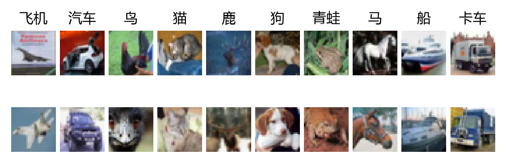

图1 CIFAR-10 数据集示例

图1选取测试集中每类的前两张图像，没有根据模型预测对错做筛选。训练阶段使用随机裁剪、水平翻转做数据增强；验证集和测试集只做张量转换和归一化处理，不使用任何随机增强操作。

<a id="section-2"></a>

## 2 ResNet18基线结构

ResNet-18 是经典的残差卷积网络，依靠卷积层提取图像特征，残差连接可以缓解深层网络训练难的问题。我参考针对 CIFAR 数据集的开源实现，保留网络的四阶段结构，每个阶段包含 2 个基础残差块。

这里补充一点实操遇到的问题：原版面向 ImageNet 的 ResNet-18 带有一个初始最大池化层，直接用在 32×32 小图上会丢失大量细节。所以我把这一层删掉，输入端改用 3×3、步长为 1 的卷积，完成对小分辨率图像的适配。这个输入层的修改，五组对比实验全部统一使用。

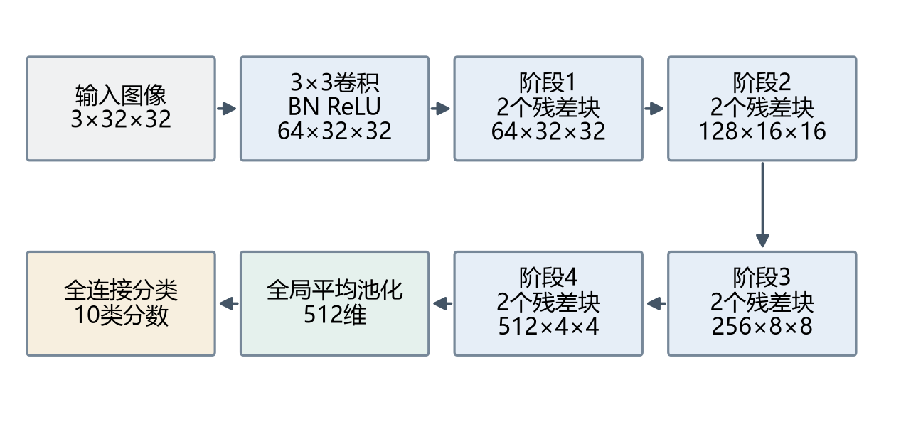

图2 CIFAR10适配版ResNet18主干结构 尺寸按通道数 高 宽表示

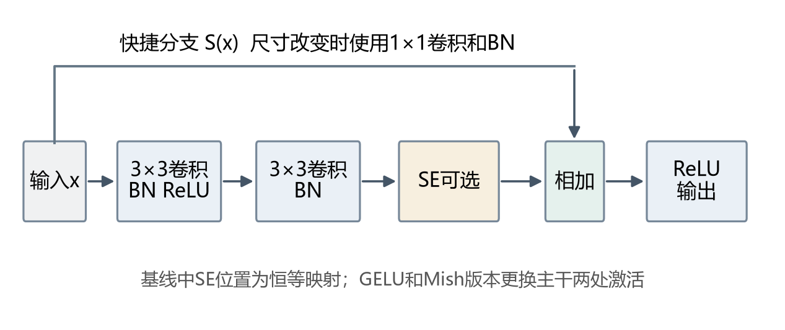

图3 残差块及本次SE插入位置 基线在可选SE位置保持恒等映射

$$
y = ReLU(F(x) + S(x))
$$

基础残差块的主分支由两个 3×3 卷积堆叠而成，执行顺序为卷积、批归一化 BN、ReLU 激活、卷积、BN；处理完之后和快捷分支结果相加，再经过激活输出。

当输入输出特征尺寸一致时，快捷分支直接做恒等映射；如果需要下采样或者改变通道数量，快捷分支就使用 1×1 卷积搭配 BN 来完成维度匹配。 网络四个阶段输出特征尺寸分别为 64×32×32、128×16×16、256×8×8、512×4×4。 网络末尾使用全局平均池化得到 512 维特征向量，再接一层全连接层输出 10 个类别的预测分数。ResNet-18 命名里的 18 层，指主路径上 17 个卷积层加上 1 个全连接层，BN 层、激活层以及快捷分支的卷积不计入层数统计。

<a id="section-3"></a>

## 3 深度可分离卷积改进

普通标准卷积会一步同时完成空间特征提取和通道之间的信息混合。而深度可分离卷积把这两件事拆分成两步：先做逐通道卷积提取空间特征，再通过 1×1 的逐点卷积完成通道融合。

这种拆分方式可以降低单层卷积的参数量和乘加计算量，但也会改变特征交互的方式，因此不能只靠公式纸上谈兵，需要实际跑训练来观察精度的变化，权衡性能与开销。

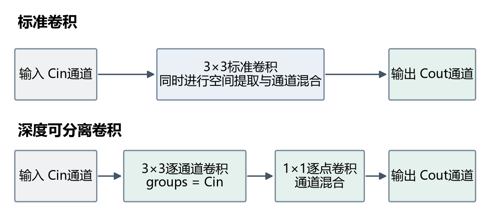

图4 标准卷积与深度可分离卷积的计算分解

设卷积核边长为k，输入通道为Cin、输出通道为Cout，忽略偏置时，两种卷积的参数量为：

$$
{P}_{standard} = {k}^{2} \cdot  {C}_{in} \cdot  {C}_{out}
$$

$$
{P}_{depthwise} = {k}^{2} \cdot  {C}_{in} + {C}_{in} \cdot  {C}_{out}
$$

$$
\frac{{P}_{depthwise}}{{P}_{standard}} = \frac{1}{{C}_{out}} + \frac{1}{{k}^{2}}
$$

在代码实现上，我只替换 8 个残差块主分支内部的 16 处 3×3 标准卷积。输入层卷积、shortcut 快捷分支的 1×1 投影卷积，还有 BN、ReLU 的位置全部保持原样。下采样的步长设置放在逐通道卷积层；逐通道卷积和逐点卷积之间，不再额外增加 BN 和激活层，尽可能只把变量控制在卷积结构本身。

改造后的网络，阶段数量、通道数、输出特征尺寸全部和基线模型保持一致，方便直接横向对比效果。要注意，网络还有部分卷积层没有替换成深度可分离，因此整套网络实际的参数、计算量削减比例，不能直接套用单层卷积的理论公式，必须统计完整前向传播的真实结果。

<a id="section-4"></a>

## 4 SE注意力与激活函数对照

### SE通道注意力

SE 模块的核心思路是给不同特征通道分配不同的权重。它先通过全局平均池化把每个通道的全局信息汇总起来，再经过降维、ReLU 激活、升维，最后用 Sigmoid 算出各个通道的权重系数。

我把 SE 模块加到每一个残差块里，位置放在第二个 BN 层之后、残差分支相加之前，整个网络一共插入 8 个 SE 模块，压缩比设置为 16。模块内部降维和升维操作都采用带偏置的 1×1 卷积实现，加入之后不会改变特征图的尺寸大小

。

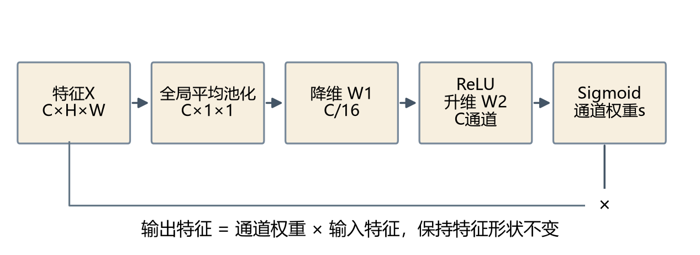

图5 SE通道权重生成与特征重标定

$$
s = sigmoid({W}_{2} ReLU({W}_{1} GAP(X)))
$$

加入 SE 之后，网络一共新增 89080 个参数，主干部分的卷积、BN、ReLU 全部沿用基线模型，没有改动。SE 内部的池化、通道缩放操作确实会带来一定计算消耗，但这部分开销没有被统计进卷积和全连接层的 MACs 指标当中。

### ReLU GELU Mish对照

GELU 和 Mish 都属于平滑型激活函数：GELU 是将输入和标准正态分布累积函数相乘；Mish 则是输入乘以经过 tanh 处理后的 softplus 结果。

实验中我直接把网络主干里全部 17 处 ReLU 分别替换成 GELU 和 Mish，网络其他结构完全和基线保持一致。为了保证对照公平，我没有针对这两种新激活单独调学习率、改初始化参数，全部沿用同一套超参数。

$$
GELU(x) = x \Phi (x)      Mish(x) = x tanh(ln(1 + {e}^{x}))
$$

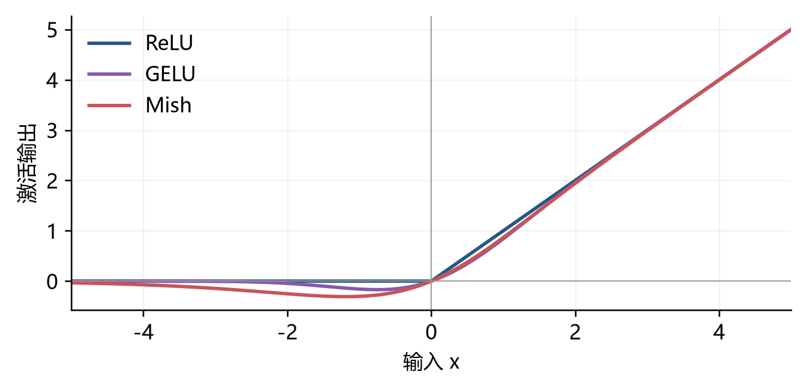

图6 三种激活函数的解析曲线 该图不是训练精度曲线

<a id="section-5"></a>

## 5 实验控制与训练配置

五组模型全部从零开始训练，不加载 ImageNet 预训练权重。为了保证对比有效，所有实验共用一套训练样本索引、数据增强策略、batch 大小、优化器以及学习率方案，训练轮次同样统一为 200 轮。每一组只改动一处网络结构，避免多个变量混杂在一起。

我设置随机种子 seed=42 来固定各类随机操作。但不同模型的参数量不一样，程序内部调用随机数的次数会有差异，所以各个模型没办法做到完全一模一样的初始权重

。

表3 统一训练配置

| 设置项 | 实际取值 |
| --- | --- |
| 数据划分 | 分层训练45000 验证5000 测试10000 |
| 输入与增强 | 32×32 RGB 随机裁剪 padding=4 水平翻转 |
| 归一化均值 | 0.4914  0.4822  0.4465 |
| 归一化标准差 | 0.2470  0.2435  0.2616 |
| 训练与评估批次 | 训练128 验证及测试256 |
| 轮数与随机种子 | 200轮 seed=42 |
| 优化器 | SGD 初始学习率0.1 momentum=0.9 |
| 权重衰减 | 0.0005 |
| 学习率计划 | CosineAnnealingLR T_max=200 |
| 损失与数值精度 | 交叉熵 FP32 |
| 初始化 | PyTorch层默认初始化 与参考实现一致 |
| 可复现设置 | 确定性算法 固定Python NumPy Torch及加载器随机源 |
| 加载与CPU线程 | 每组2个加载进程 2个计算线程 |

$$
{\eta }_{t} = \frac{{\eta }_{0}}{2} [1 + cos(\pi t/T)]
$$

公式中t代表已经完成的学习率调度步数，总轮数T=200，训练初始学习率为 0.1，每一轮训练结束后更新学习率。每一轮的损失、准确率、当前学习率、训练耗时都会保存到history.csv文件。

### 模型选择与运行环境

挑选模型权重时，优先选择验证集准确率最高的；如果准确率相同，就选取验证损失更小的权重。所有模型训练结束之后，只用选出的最优权重去跑测试集。运行环境为Python 3.13.9、PyTorch 2.6.0+cu124、TorchVision 0.21.0+cu124、NumPy 2.1.2和Pillow 11.2.1。

<a id="section-6"></a>

## 6 最终分类结果

五组模型都完整跑完 200 轮训练，表 4 的数据全部读取自实验输出的metrics.json文件。测试集准确率基于 10000 张测试图片的预测结果统计得到；宏 F1 是把 10 个类别的 F1 分数做等权平均。CIFAR-10 测试集每一类都刚好 1000 张样本，宏 F1 可以帮我们补充观察不同类别上模型的综合表现。

表4 最佳验证权重对应的最终测试结果

| 模型 | 最佳轮次 | 验证准确率<br>百分比 | 测试准确率<br>百分比 | 宏F1 |
| --- | --- | --- | --- | --- |
| 基线 | 194 | 95.64 | 94.95 | 0.9494 |
| 深度可分离 | 177 | 95.10 | 94.43 | 0.9443 |
| SE | 189 | 95.78 | 95.21 | 0.9522 |
| GELU | 183 | 95.08 | 94.49 | 0.9450 |
| Mish | 198 | 94.52 | 93.76 | 0.9375 |

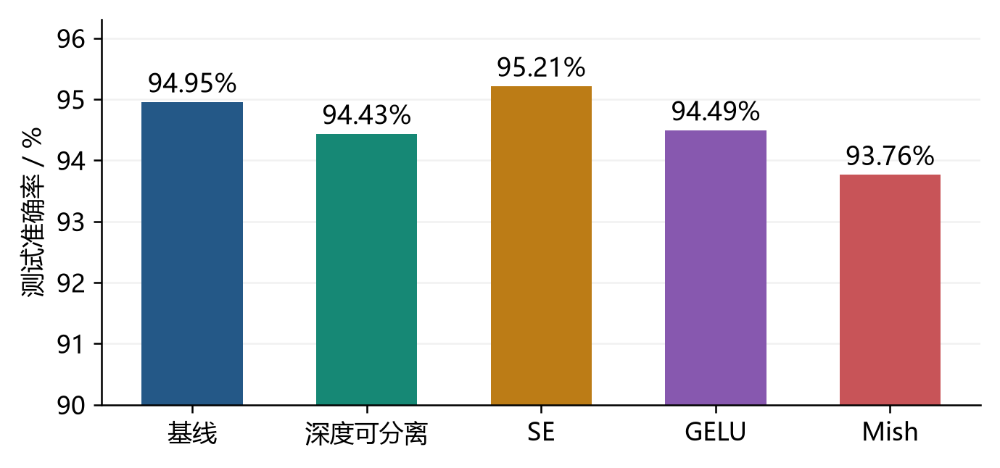

图7 五组测试准确率对比 纵轴从90百分比开始以便观察小幅差异

基线模型一共正确识别 9495 张图片，测试准确率 94.95%；加入 SE 注意力的模型正确识别 9521 张，准确率达到 95.21%，相比基线多识别 26 张图像，提升 0.26 个百分点。虽然 SE 模型拿到本次实验里最高的准确率，但提升幅度很小，而且我只使用了一组随机种子，不能直接认定这个提升是稳定可靠的。

GELU、Mish 的测试准确率分别为 94.49% 和 93.76%，相比基线分别下降 0.46、1.19 个百分点。可以看出，在这套固定的训练轮数和超参数条件下，直接换成更加平滑的激活函数并不会自动带来性能提升。当然，这不代表这两个激活函数在别的数据集、别的任务上同样效果不好。

<a id="section-7"></a>

## 7 训练过程与收敛分析

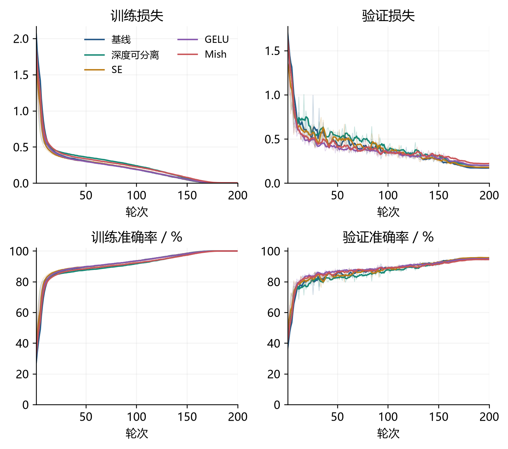

图8 全部200轮学习曲线 细线为逐轮真实值 粗线为后向5轮均值

观察学习曲线能够看到，五组模型的训练损失整体都在逐步下降，训练集准确率最后都接近 100%；验证集准确率也不断上升，后期变化慢慢趋于平缓。不过训练前期验证曲线波动比较明显，这也说明了不能直接拿最后一轮的模型当最终结果，我需要从训练保存的权重里挑选验证集表现最好的一份来做后续评估。

拿基线模型举例，训练到最后一轮时训练准确率已经达到 100.00%，但验证准确率只有 95.64%，它效果最好的权重实际出现在第 194 轮。训练集效果几乎拉满，但验证集还有不小差距，说明模型存在一定泛化问题，不能只看训练集准确率就判断模型分类能力已经完全达标。

从曲线可以确认所有模型都正常收敛，但单凭曲线没办法证明某一个网络组件就一定会带来对应的效果。激活函数的实验结果受这套固定优化参数的限制；SE 模块带来的微弱提升，也需要更换多组随机种子重复实验来进一步验证。本次全部实验损失数值均未出现爆炸、NaN 等异常，训练日志和样本预测结果我都做过核对校验。

<a id="section-8"></a>

## 8 参数量与理论计算量分析

表5 真实模型统计与训练循环计时

| 模型 | 参数量 | MACs<br>百万 | FLOPs<br>十亿 | 训练时间<br>分钟 |
| --- | --- | --- | --- | --- |
| 基线 | 11,173,962 | 555.423 | 1.1108 | 43.78 |
| 深度可分离 | 1,439,626 | 73.049 | 0.1461 | 35.82 |
| SE | 11,263,042 | 555.510 | 1.1110 | 48.98 |
| GELU | 11,173,962 | 555.423 | 1.1108 | 44.15 |
| Mish | 11,173,962 | 555.423 | 1.1108 | 44.96 |

MACs 是给网络输入尺寸1×3×32×32，通过 PyTorch 前向钩子统计卷积层、全连接层的乘加运算；FLOPs 按2×MACs换算。统计的时候没有计入 BN、激活函数、池化、偏置加法以及通道缩放这类运算。

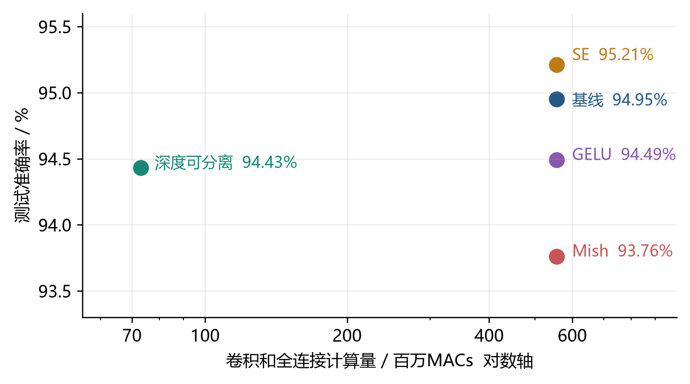

图9 精度与卷积及线性层MACs的关系 横轴使用对数刻度

深度可分离改造之后，模型参数量从 1117 万下降到 144 万，降幅 87.12%；MAC 计算量下降 86.85%，代价仅仅是测试准确率降低 0.52 个百分点。

表格里记录的时间只是模型循环训练的耗时，不包含程序启动、保存权重、测试推理的开销。另外实验使用多卡排队运行，Mish 组运行时还出现过 CPU 资源争抢，所以这里的训练时长不能直接拿来当作不同网络推理速度的对比依据。五组实验整体调度跑完总耗时 87.47 分钟，只作为本次硬件资源使用记录。

<a id="section-9"></a>

## 9 类别混淆分析

我选用本次效果最好的 SE 模型，分析它在测试集上的错分情况。混淆矩阵如图 10 所示，矩阵行代表图片真实类别，列代表模型给出的预测类别，格子内数字为样本数量；测试集每一类都正好 1000 张样本。矩阵对角线上的数据代表预测正确的样本，不在对角线上的数值就是发生混淆错分的样本。

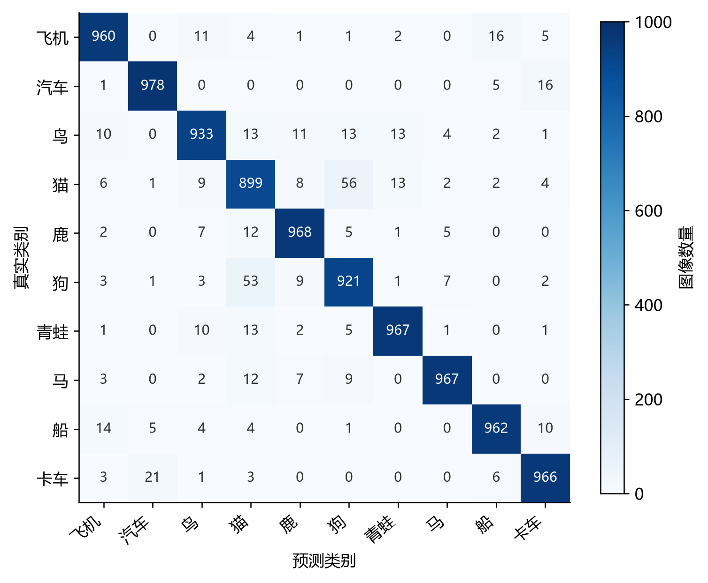

图10 SE模型在独立测试集上的完整混淆矩阵

SE 模型总共错分 479 张图片。混淆情况比较突出的几组分别是：猫被识别成狗一共 56 张，狗被识别成猫一共 53 张；还有 21 张卡车被误判成汽车。CIFAR-10 图片只有 32×32 的低分辨率，部分类别物体轮廓、画面背景本身就很相似。

<a id="section-10"></a>

## 10 类别表现与失败样例

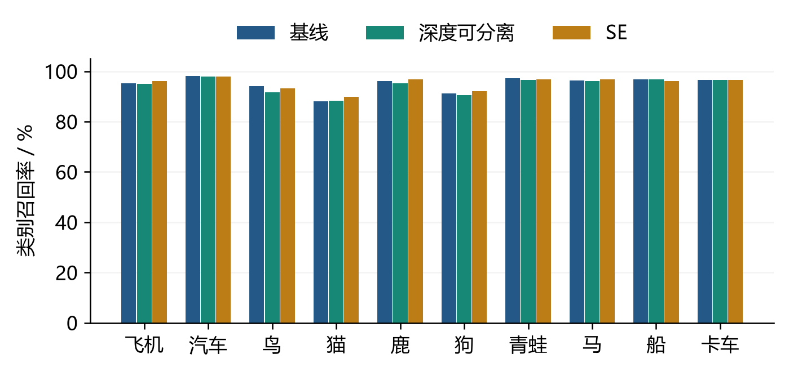

图11 基线 轻量化 SE模型的逐类召回率 每类测试图像1000张

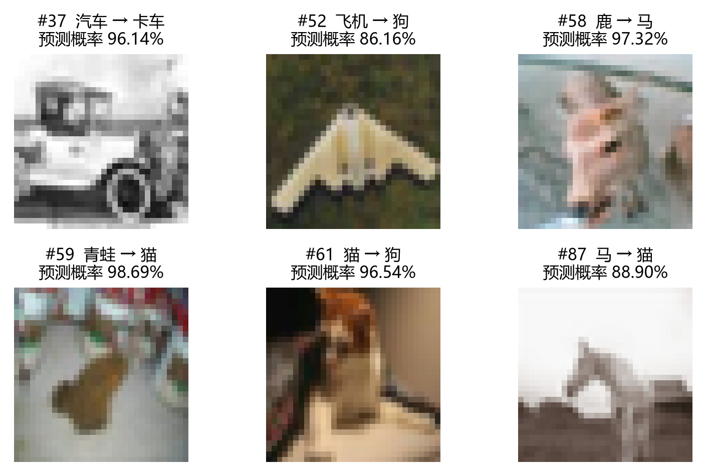

图12 SE按测试序号取前6个误分类样本 该图不是随机准确率估计

展示的错误样本都保留原始 32×32 分辨率，只是做放大显示，没有修改或者重新生成图片。我直接按照测试集样本顺序截取前 6 个错分样本，没有特意挑选看起来有代表性的图片。图中标注的概率是 softmax 输出、模型对预测类别的置信度，并不代表经过校准的真实正确率。

举个例子，#37 号样本真实标签是汽车，但模型把它识别成卡车，置信度甚至高达 96.14%。这也能看出一个问题：就算模型输出很高的置信概率，预测结果依旧有可能出错。

<a id="section-11"></a>

## 11 讨论与结论

### 结构组件的实验含义

加入 SE 通道注意力模块后，测试准确率由基线的 94.95% 提升至 95.21%，新增参数量只占基线模型的 0.80% 左右。从本次实验结果来看，在 CIFAR-10 数据集和 200 轮训练条件下，SE 模块存在一定的性能增益。不过准确率提升仅有 0.26 个百分点，这个小幅提升有可能来自随机种子、训练优化过程带来的波动，如果想要确认效果是否稳定，还需要多组重复实验来验证。

深度可分离卷积的方案，仅仅牺牲 0.52 个百分点的测试准确率，就实现参数量降低 87.12%、MAC 计算量下降 86.85%。这个改动很适合用来权衡模型精度和轻量化需求。如果项目更看重分类准确率，那 SE 改进版本效果更好；如果设备存储空间、算力比较紧张，轻量化模型会更合适。实际选择网络不能只盯着准确率这一项指标，要结合硬件资源综合判断。

GELU、Mish 相比于 ReLU，函数曲线更加平滑，对负数输入的处理方式也不一样，但这不代表直接替换就能提升模型效果。在本套固定的初始化、学习率配置下，这两种激活函数的表现都比不上 ReLU。

### 结论

本次大作业以经典卷积网络 ResNet-18 作为基础，设置五组训练条件完全一致的对照实验，分别测试深度可分离轻量化卷积、SE 通道注意力、GELU 与 Mish 激活函数的实际效果。 实验得到可复现的基线测试准确率 94.95%；加入 SE 注意力后拿到本组实验最高的 95.21%；深度可分离轻量化模型大幅压缩参数和计算量，依旧可以保持 94.43% 的测试准确率。 通过对照，我看到了部分网络改动能够带来收益，也有部分论文中表现优秀的组件，直接照搬过来并没有效果。最后我还利用轻量化权重搭建了可以直接运行的图片分类演示原型，完整走完了网络组件修改、对照实验验证、面向应用权衡选型这一整套流程。

<a id="run"></a>

## 运行说明

正式实验在 Linux、NVIDIA A10、Python 3.13.9、PyTorch 2.6.0+cu124 环境完成。训练入口要求 CUDA；图片分类推理入口使用 CPU。以下命令在项目根目录执行，使用独立虚拟环境。

```bash
git clone https://github.com/6-w-k/cnn_coursework.git
cd cnn_coursework
python3 -m venv .venv
source .venv/bin/activate
python -m pip install -r requirements-container.txt
python scripts/prepare.py
```

`requirements-container-lock.txt` 保存正式训练环境的完整依赖版本。先使用 `requirements-container.txt` 安装核心依赖，或在匹配的 Linux/CUDA 环境使用完整锁定文件。驱动需支持相应 CUDA 版本。

### 验证与训练

```bash
# 真实样本、五组结构和断点恢复检查
CUDA_VISIBLE_DEVICES=0 python scripts/verify_experiments.py
# 单卡训练一组；variant 可选 baseline/depthwise/se/gelu/mish
CUDA_VISIBLE_DEVICES=0 python scripts/train.py --variant baseline --output runs/baseline
# 四卡排队训练五组，配置见 experiments/plan.json
python scripts/launch_experiments.py --run-dir runs/new_run
python scripts/training_status.py runs/new_run
```

启动四卡调度前，按实际硬件修改 `experiments/plan.json` 的 `gpus`。调度器检查显卡占用，每张卡同时只安排一个本项目进程。固定划分为训练45000、验证5000、测试10000；五组各200轮，随机种子42；按验证集选择权重后评估测试集。

### 复核结果与图片推理

```bash
python scripts/summarize_results.py results/formal_75f7c238
python scripts/predict.py report/application/depthwise_inference.pt report/application/test_00003.png
```

仓库包含正式轻量化模型的推理权重和3张演示输入。预测脚本输出前三个类别和概率。其余各组完整训练检查点未上传；五组正式指标、200轮历史及10000条测试预测均在 `results/formal_75f7c238/`。

<a id="dataset"></a>

## 数据集与样例

按本项目提交范围，完整 CIFAR-10 数据集不上传到仓库。`samples/` 包含真实训练集导出的20张32×32 PNG，每类两张；它们用于浏览，不能代替完整训练数据。

完整数据可从 [CIFAR-10 官方页面](https://www.cs.toronto.edu/~kriz/cifar.html) 获取，或执行 `python scripts/prepare.py` 自动下载。脚本校验官方 Python 压缩包 MD5 `c58f30108f718f92721af3b95e74349a`。原始数据以 Python 批文件存储，无需把60000张图片全部导出成 PNG。

## 代码与文件

| 路径 | 内容 |
|---|---|
| `cnn/` | 五组 ResNet-18 模型、数据加载、结构开销统计 |
| `scripts/` | 数据准备、训练、校验、调度、推理、汇总及 Word 转 Markdown |
| `experiments/plan.json` | 五组共享配置 |
| `splits/seed42.json` | 固定分层数据索引 |
| `results/formal_75f7c238/` | 实验输出、逐样本预测及原始训练源码快照 |
| `docs/report.docx` | 用户修改后的 Word 原件 |
| `docs/images/` | 从这份 Word 中逐张提取的报告配图 |
| `docs/report_conversion.json` | Word 文件哈希与转换记录 |
| `samples/` | 20张真实数据样例 |
| `report/application/` | 正式轻量权重及可运行分类示例 |
| `references/` | 参考源码快照、提交记录及原许可证 |

## 参考实现与来源

ResNet 原理参考 [Deep Residual Learning for Image Recognition](https://arxiv.org/abs/1512.03385)。小图像 ResNet 实现参考 [kuangliu/pytorch-cifar](https://github.com/kuangliu/pytorch-cifar)，另用 [TorchVision ResNet](https://github.com/pytorch/vision/blob/main/torchvision/models/resnet.py) 核对结构。上游代码保留其各自许可证；详细版本见 `references/sources.json`。CIFAR-10 归原数据集作者所有。
